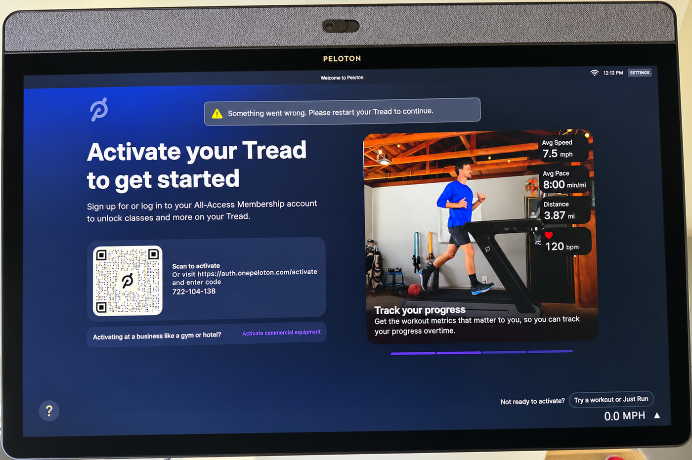
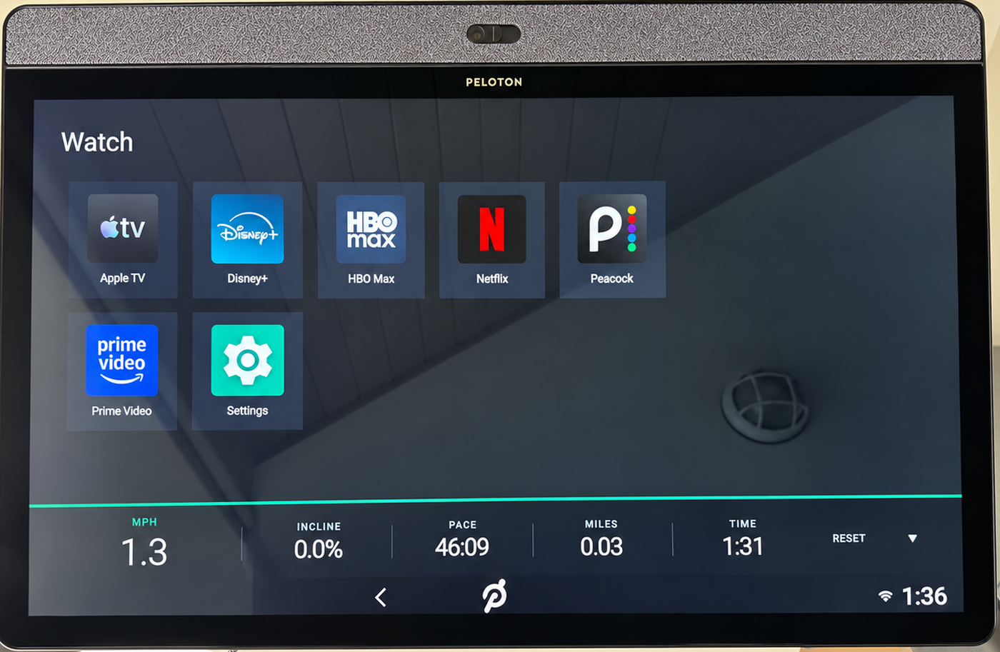
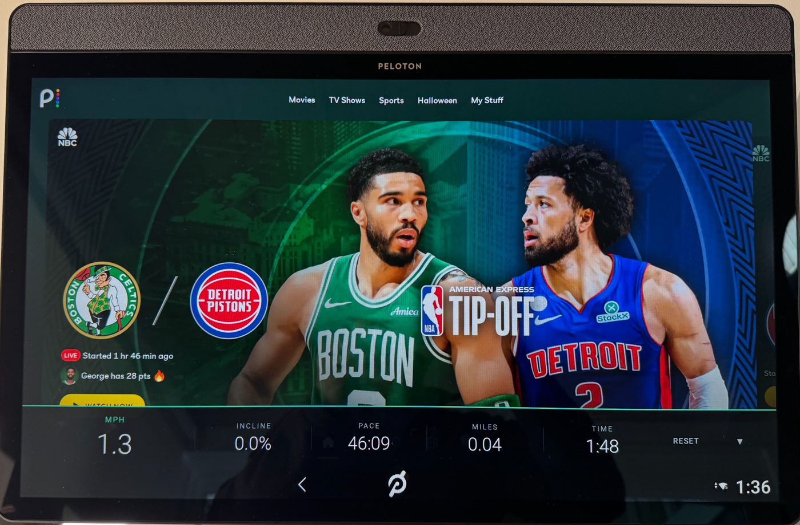

# Peleton Tread

Experimental software for a Peloton Tread you already own. No warranty. Not affiliated with Peloton. Not legal advice. Details are in [Read this before you use it](#read-this-before-you-use-it).

## Bottom line

You get a home screen called **Watch** that opens the streaming apps installed on the treadmill, and a bar along the bottom with speed, incline, pace, miles, and time while a show is playing.

The belt, the speed and incline knobs, and the red safety key stay Peloton's. The passcode pad, the sign-in nags, and the welcome screen that is mostly a membership pitch come off. `app/revert.sh` puts those Peloton screens back.

You do not get Peloton classes, a Google account on the tablet, YouTube TV, or a new operating system. This is not the kind of project that replaces the tablet's system software.

## The issue

You can use a Peloton treadmill you own without paying for Peloton's All-Access membership. Peloton's own screen says so. On a Tread that was never activated, or whose membership was canceled, the screen offers **Try a workout or Just Run**. That is Peloton's feature. It shows the belt can run without that subscription. It does not mean the machine is completely free of an account, and it does not mean it is a normal offline tablet.

That stock screen is still a bad fit if the only goal is to run and watch a show. A passcode has to be entered, messages about signing in have to be dismissed, and almost the whole welcome screen is a pitch for a service the owner does not want.



*Example of that welcome screen. The membership pitch takes the page. "Try a workout or Just Run" is Peloton's own button, tucked in the corner.*

## What this project puts on the screen

This project installs a separate app, makes that app the Home screen, and turns off the Peloton packages that draw the welcome screen, the passcode keypad, and a bar that was force-closing other apps. It does not replace the operating system, bypass a lock screen or encryption, copy Peloton's code, or change the belt controller. The hardware safety key is left alone. Person-present auto-stop stays in Peloton's controller. `app/revert.sh` turns the Peloton packages back on and restores the previous Home screen.



*Example of the Watch screen. The five numbers on the bar are the same size. RESET clears the distance and the timer on the bar. It does not stop the belt.*



*Example of a show with the bar still on screen. The knobs still change speed and incline. The safety key still stops the belt; confirm that once before you trust it.*

## What you need

- The treadmill's tablet, a computer, and a USB-C cable that carries data. A charge-only cable will not show up.
- USB debugging already available on the tablet, and the on-screen prompt accepted. This project has no way to turn debugging on if the tablet will not let you.
- [Android platform-tools](https://developer.android.com/tools/releases/platform-tools) so the `adb` command exists.
- To compile the app: a JDK, Android SDK platform `android-29`, and build-tools `34.0.0`.

The notes below are from one original Peloton Tread, 2021, Android 10, arm64, 1920×1080, model string `PLTN-TTR01`. A Tread+, a Bike, or a later Android version can behave differently. `app/apply.sh` stops immediately if the tablet does not have the Tread controller package, and it does not change anything in that case.

## Hand this to an assistant

A repo is a project folder with a saved history of changes. This one is private: it is not on the public internet. Someone can use it only if you invite them from the repo page.

If you have a computer, a data USB-C cable, and an assistant such as Cursor:

1. Plug the Tread into the computer with the data cable.
2. Open this folder in Cursor (File → Open Folder).
3. Paste this into the chat:

```
Read README.md and AGENTS.md. The Tread is plugged in over USB. Follow AGENTS.md exactly. Do not root the tablet, do not replace the operating system, and do not modify the belt controller or the safety key. If this tablet is not an original Peloton Tread running Android 10, stop and tell me before you change anything.
```

The assistant does the build and the install. You enter the Tread Lock PIN once, on the treadmill, if it asks. That PIN stays on the tablet. It is not saved in this repo.

To put Peloton's screens back, tell the assistant: "Run app/revert.sh and reboot the Tread."

## What held up, and what did not

These are notes from exercising this software on that one Android 10 Tread. They are not a promise about your machine.

**Held up**

- Watch lists the apps already installed on the tablet (on that machine: Apple TV, Disney+, HBO Max, Netflix, Peacock, Prime Video, Settings) and launches them.
- The metrics bar reads speed, incline, pace, miles, and time. All five numbers are the same size. The bar sits on top of a show and does not steal clicks from the show.
- The physical speed knob and incline knob still change the belt, in the same 0.1 mph and 0.5% steps as Just Run.
- The passcode is requested once. After that the app remembers it on the tablet and clears Tread Lock itself, including after a reboot. The safety key is a separate mechanism and is not part of that.
- Turning the three Peloton UI packages back on with `app/revert.sh`, then rebooting, restores Peloton's chrome.
- The tablet has Bluetooth. Pairing headphones is the ordinary Android Bluetooth screen (Settings → Connected devices). This project does not set that up. AirPods, if they connect, connect as ordinary Bluetooth headphones, without Apple-only features.

**Did not hold up**

- A Google account. The tablet has no Accounts section, and Google Play services will not keep running when it is installed as a normal app on this locked Android build. The process dies on a platform security check (`ActivityManagerService.isSingleton`). Rebooting does not fix it. microG is not an option without signature spoofing, and this build does not have that. Do not root the tablet to chase it.
- YouTube TV. It opens and sits on a spinner. It needs an account, which this tablet cannot add.
- The Play Store as a way to install apps. The app can be installed and still cannot sign in or download anything.
- Signed-in YouTube. Signed-out playback of a public video did work, and only after Google Services Framework was installed and YouTube was installed again afterward so it could read that framework. The first launch took about half a minute, then the video played. An account still could not be added. Play services also logged that it was older than the version YouTube asked for, and the video played anyway. Skip this unless signed-out YouTube is specifically the goal. It uses several hundred megabytes on a tablet whose data partition is about 4 GB.
- Replacing the operating system, unlocking the bootloader, or flashing a different system. This repo does not do that. The tablet above is a locked user build with no root. Projects that talk about doing that to a Peloton Bike are a different project.

**Behavior worth knowing**

- After the belt has moved once, TIME keeps counting until you press RESET, including while the belt is stopped. RESET clears the numbers on the bar. It does not stop the belt. The safety key stops the belt.
- The first time YouTube is opened after boot, if the extra Google files are present, it waits on Play services and then gives up and plays. Later opens are faster.
- Leave a few hundred megabytes free on `/data`. Filling the tablet makes installs fail.

## Put it back

```bash
app/revert.sh
adb reboot
```

That re-enables the Peloton UI packages and restores the Home screen that was in place before the first apply. Reboot once. The Watch app is still installed until you remove it:

```bash
adb uninstall com.treadcover
```

Uninstalling also deletes the PIN the app stored. Nothing in this repo contains that PIN.

## Read this before you use it

This is experimental software. It is published so it can be read and, if you choose, tried on equipment you own. There is no warranty of any kind. It might not work on your Tread. It might leave the screen in a state you have to undo with `app/revert.sh`. It can affect warranty coverage and Peloton's willingness to support or reactivate the machine. You use it at your own risk. The author is not responsible for damage, injury, a lost warranty, or a dispute with Peloton or anyone else.

This is not legal advice, and it is not a statement that any particular person has modified a Peloton product. Peloton's "Try a workout or Just Run" button is their feature, described here because it is on their screen. It is not a ruling about your contract. Your purchase terms, your membership terms, and the law where you live are yours to check. Nothing here tells you to break a law or a contract.

This project is not affiliated with, endorsed by, or supported by Peloton Interactive, Inc. "Peloton" is their trademark. This repository does not contain Peloton's software, Peloton's firmware, or a copy of their operating system.

The same caution the Bike projects use applies here, with one difference. Those projects often replace the operating system. This one does not. It is an app, a home-screen setting, and three disabled user-interface packages, all reversible. That difference does not make it safe, legal for you, or supported. Treat it as an experiment. If you are unsure, do not run it.
