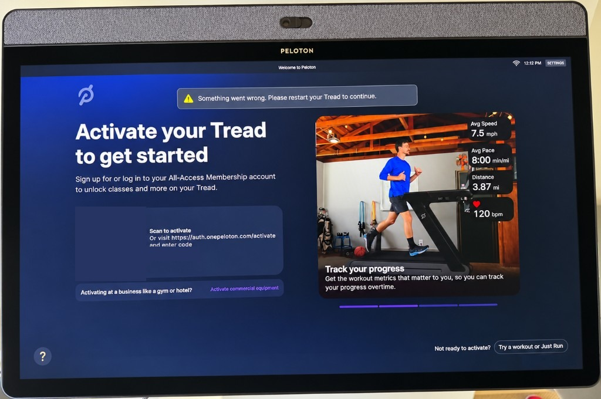

# Peloton Tread

Experimental software for a Peloton Tread you already own. No warranty. Not affiliated with Peloton. Not legal advice. Details are in [Read this before you use it](#read-this-before-you-use-it).

## Bottom line

The Peloton Tread is an awesome treadmill, and it has the largest screen in the industry. That screen is a perfect place to watch a show while you walk or run. You can't use it that way by default. The tablet opens on a welcome page that is almost entirely a pitch to activate a membership and take Peloton classes.

This setup is for an owner who does not want those classes or that membership, and just wants to be entertained. You get a home screen called **Watch** that opens the streaming apps installed on the treadmill, and a bar along the bottom with incline, pace, time, miles, and speed while a show is playing. Minimized, that bar shows miles. A small sleep button in the upper right of Watch starts a screensaver, and so does leaving Watch alone for a minute. The bar and the bottom controls hide, and a spinning Peloton mark bounces the full screen. If it lands in a corner, it bursts into confetti, then starts again from the center. Hold the sleep button to see that burst. Tap to bring the apps back.

The belt, the speed and incline knobs, and the red safety key stay Peloton's. The passcode pad, the sign-in nags, and that welcome screen come off. `app/revert.sh` puts those Peloton screens back.

You do not get Peloton classes, and this does not install a new operating system.

## Why

The steps are in this repository. The reason I wanted them is here: [I Bought a Peloton Tread. Then I Hung an iPad on the Massive Screen.](https://mi.ke/tread/)

That post is about buying what I thought was the best treadmill, the long belt, the screen that could not play a show, and the iPad I hung on it. This repository is the part you can hand to an assistant. Each one links to the other, so you can start with the story or start with the setup.

## The issue

You can use a Peloton treadmill you own without paying for Peloton's All-Access membership. Peloton's own screen says so. On a Tread that was never activated, or whose membership was canceled, the screen offers **Try a workout or Just Run**. That is Peloton's feature. It shows the belt can run without that subscription. It does not mean the machine is a normal offline tablet, and the welcome page is still a bad fit when the only goal is to watch something and run.

A passcode has to be entered, messages about signing in have to be dismissed, and almost the whole screen is a pitch for a service the owner does not want.



*The welcome screen. The membership pitch takes the page. "Try a workout or Just Run" is Peloton's own button, tucked in the corner.*

## What this project puts on the screen

This project installs a separate app, makes that app the Home screen, and turns off the Peloton packages that draw the welcome screen, the passcode keypad, and a bar that was force-closing other apps. It does not replace the operating system, bypass a lock screen or encryption, copy Peloton's code, or change the belt controller. The hardware safety key is left alone. Person-present auto-stop stays in Peloton's controller. `app/revert.sh` turns the Peloton packages back on and restores the previous Home screen.


*Example of the Watch screen. The five numbers on the bar are the same size. Pause freezes time and distance and leaves the belt running. I'm sure stops the belt, then Close clears the bar.*


*Example of a show with the bar still on screen. The knobs still change speed and incline. The safety key still stops the belt; confirm that once before you trust it.*

## What you need

- The treadmill's tablet, a computer, and a USB-C cable that carries data. A charge-only cable will not show up.
- USB debugging already available on the tablet, and the on-screen prompt accepted. This project has no way to turn debugging on if the tablet will not let you.
- [Android platform-tools](https://developer.android.com/tools/releases/platform-tools) so the `adb` command exists.
- To compile the app: a JDK, Android SDK platform `android-29`, and build-tools `34.0.0`.

The notes below are from one original Peloton Tread, 2021, Android 10, arm64, 1920×1080, model string `PLTN-TTR01`. A Tread+, a Bike, or a later Android version can behave differently. `app/apply.sh` stops immediately if the tablet does not have the Tread controller package, and it does not change anything in that case.

## Hand this to an assistant

This repository is public. If you have a computer, a data USB-C cable, and an assistant such as Cursor, point the assistant at [github.com/MichaelCyger/Peloton-Tread](https://github.com/MichaelCyger/Peloton-Tread). A Mac or a PC both work. The assistant can read the instructions from that address, or you can clone the folder and open it.

1. Plug the Tread into the computer with the data cable.
2. Tell the assistant to open this repository, or open the cloned folder yourself (File → Open Folder).
3. Paste this into the chat:

```
Read README.md and AGENTS.md. The Tread is plugged in over USB. Follow AGENTS.md exactly. Do not root the tablet, do not replace the operating system, and do not modify the belt controller or the safety key. If this tablet is not an original Peloton Tread running Android 10, stop and tell me before you change anything.
```

The assistant does the build and the install. You enter the Tread Lock PIN once, on the treadmill, if it asks. That PIN stays on the tablet. It is not saved in this repo.

To put Peloton's screens back, tell the assistant: "Run app/revert.sh and reboot the Tread."

## What held up, and what did not

These are notes from exercising this software on that one Android 10 Tread. They are not a promise about your machine.

**Held up**

- Watch lists the apps already installed on the tablet (on that machine: Apple TV, Disney+, HBO Max, Netflix, Peacock, Prime Video, Settings) and launches them.
- The metrics bar reads incline, pace, time, miles, and speed, in that order. Speed is on the right. All five numbers are the same size, and the labels are the same color. Minimized, the pill shows miles. Pause freezes time and distance and leaves the belt running. I'm sure stops the belt and shows a summary. Close clears the bar. The bar sits on top of a show and does not steal clicks from the show.
- The physical speed knob and incline knob still change the belt, in the same 0.1 mph and 0.5% steps as Just Run.
- The passcode is requested once. After that the app remembers it on the tablet and clears Tread Lock itself, including after a reboot. The safety key is a separate mechanism and is not part of that.
- Turning the three Peloton UI packages back on with `app/revert.sh`, then rebooting, restores Peloton's chrome.
- The tablet has Bluetooth. Pairing headphones is the ordinary Android Bluetooth screen (Settings → Connected devices). This project does not set that up. AirPods, if they connect, connect as ordinary Bluetooth headphones, without Apple-only features.

**Did not hold up**

- YouTube TV was installed and tried. It opens onto a spinner and never becomes usable. It depends on Google Play services, and this tablet's Android will not keep Play services running. The services process is blocked by the system, and a reboot does not change that. The streaming apps already on the Watch screen, such as Netflix and Prime Video, do not need Play services, and those are the ones that work.
- Replacing the operating system, unlocking the bootloader, or flashing a different system. This repo does not do that. The tablet above is a locked user build with no root. Projects that talk about doing that to a Peloton Bike are a different project.

**Behavior worth knowing**

- After the belt has moved once, TIME keeps counting while the belt is stopped. It freezes when you tap the pause button, or when you tap "I'm sure" to confirm on the stop modal. Miles count only while the belt is moving, and they freeze at the same time.
- The pause button leaves the belt running and pauses a show that is playing. Tap the play button on the bar and TIME starts again. Miles pick up only while the belt is moving. The show stays paused, and the belt stays as it is.
- "I'm sure" is the confirmation on the stop modal. It freezes those numbers, sets the belt to 0 mph, and shows the summary. Close clears the numbers and leaves the belt at 0 mph. The safety key still stops the belt on its own.
- The screensaver starts after a minute of no use and no touch, or when you tap the sleep button. Hold that button for the corner burst. While it is up, the metrics bar and the bottom row are hidden. TIME keeps counting, and the belt is unchanged. Tap the screen to bring the Watch view back.
- Leave a few hundred megabytes free on `/data`. Filling the tablet makes installs fail.

## Put it back

```bash
app/revert.sh
adb reboot
```

That re-enables the Peloton UI packages and restores the Home screen that was in place before the first apply. Reboot once. The Watch app is still installed until you remove it:

```bash
adb uninstall com.treadcover
```

Uninstalling also deletes the PIN the app stored. Nothing in this repo contains that PIN.

## Read this before you use it

This is experimental software. It is published so it can be read and, if you choose, tried on equipment you own. There is no warranty of any kind. It might not work on your Tread. It might leave the screen in a state you have to undo with `app/revert.sh`. It can affect warranty coverage and Peloton's willingness to support or reactivate the machine. You use it at your own risk. The author is not responsible for damage, injury, a lost warranty, or a dispute with Peloton or anyone else.

This is not legal advice. Peloton's "Try a workout or Just Run" button is their feature. It is not a ruling about your contract. Your purchase terms, your membership terms, and the law where you live are yours to check. Nothing here tells you to break a law or a contract.

This project is not affiliated with, endorsed by, or supported by Peloton Interactive, Inc. "Peloton" is their trademark. This repository does not contain Peloton's software, Peloton's firmware, or a copy of their operating system.

The same caution the Bike projects use applies here, with one difference. Those projects often replace the operating system. This one does not. It is an app, a home-screen setting, and three disabled user-interface packages, all reversible. That difference does not make it safe, legal for you, or supported. Treat it as an experiment. If you are unsure, do not run it.

## Easter Egg Fun

There's an Easter egg in the sleep screensaver that is inspired by The Office.

You know the episode... everyone stops work, waiting for the screensaver logo to hit the corner because they don't know what to expect.

<video src="https://github.com/user-attachments/assets/e8f2e92e-81eb-47fd-8d3b-5408de9a76ec" controls width="100%" playsinline></video>
